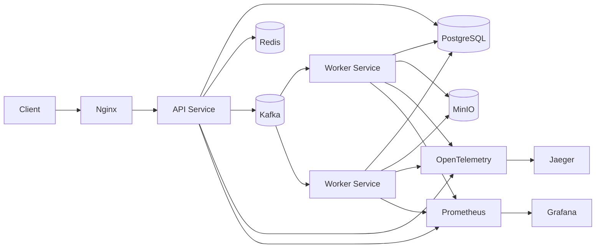

# Distributed AI Inference Platform

A distributed asynchronous AI inference platform built in Java with Spring Boot, Kafka, PostgreSQL, Redis, MinIO, Docker Compose, and observability tooling. The platform accepts inference jobs over HTTP, persists them in PostgreSQL, publishes work to Kafka, processes them asynchronously in a worker tier, stores results in object storage, and exposes status/results back to the client.

Status: Phases 0-21 are complete. Phases 22-25 remain on the roadmap.

## Project snapshot

- Stack: Java 21, Spring Boot 3.3.4, Maven, PostgreSQL 16, Flyway, Redis, Kafka (KRaft), MinIO, Nginx, Resilience4j, Prometheus, Grafana, OpenTelemetry, Jaeger, JUnit 5, Mockito, Testcontainers, k6, Docker Compose.
- Primary API service: services/api-service
- Worker service: services/worker-service
- Infrastructure: infrastructure/docker/docker-compose.yml, infrastructure/nginx/
- Monitoring: monitoring/prometheus, monitoring/grafana
- Load tests: tests/k6
- Documentation: docs/

## What the platform does

An end-user submits a job through a REST API and receives a `202 Accepted` with a job ID. The request is stored in PostgreSQL and published to Kafka. A dedicated worker service consumes the job, invokes an AI provider, stores the result in S3-compatible object storage (MinIO), and marks the job as `COMPLETED`.

This design separates the write path from the compute path so the API remains responsive even when job execution is delayed or retried.

## Architecture



## Current status by phase

| Phase | Topic | Outcome |
|---|---|---|
| 0 | Environment setup | JDK 21, Maven, Docker/WSL2, Git, repository skeleton |
| 1 | Spring Boot skeleton | API service starts; `/actuator/health` reports `UP` |
| 2 | PostgreSQL + Flyway + entities | Users, jobs, job_events, and idempotency keys tables created; `ddl-auto: validate` |
| 3 | Auth + JWT | Register/login, BCrypt, stateless JWT filter, centralized error handling |
| 4 | Job APIs | Create/get/list/cancel/result flows implemented with ownership checks and JSONB parameters migration |
| 5 | AI provider + object storage abstraction | `AiProvider` and `ObjectStorage` interfaces with Mock/OpenAI providers and MinIO presigned URLs |
| 6 | Kafka producer | Topics created with explicit partitioning and jobs transition to `QUEUED` after publish |
| 7 | Worker service | Separate Maven module, job-state guard, manual offset commit, temporary `/process` endpoint removed |
| 8 | Retry + DLQ | Failure classification, exponential backoff with jitter, `ai-jobs-dlq` |
| 9 | Redis cache | Cache-aside for job status with user-scoped cache keys |
| 10 | Rate limiting | Redis fixed-window limiter, 100 jobs/h per user and 10 auth requests/h per IP, `429` with `Retry-After` |
| 11 | Idempotency | `Idempotency-Key` header support with composite key `(key + userId)` |
| 12 | Priority jobs | High/normal/low topics with strict precedence via `PriorityJobPoller` |
| 13 | Timeout + circuit breaker | Resilience4j breaker and time limiter around AI provider and storage |
| 14 | Nginx + multiple API instances | Round-robin API balancing; shared Redis rate limiter confirmed statelessness |
| 15 | DB read scaling | Real PostgreSQL streaming replica and `AbstractRoutingDataSource`; only `listJobs` routed to the replica |
| 16 | Prometheus + Grafana | Both services scraped; Grafana connected to Prometheus |
| 17 | Structured logging | JSON logging with `service`, `jobId`, and `errorCode` via MDC |
| 18 | OpenTelemetry | Java agent, Jaeger, manual Kafka context propagation, real `traceId` in error responses |
| 19 | Automated tests | 38 tests passing (31 worker + 7 API); exception unwrapping bug in `FailureClassifier` fixed |
| 20 | k6 load testing | Initial benchmark completed; see measured results |
| 21 | Chaos testing | Seven scenarios exercised; see findings |
| 22 | Docker production-like environment | Planned: multi-stage Dockerfiles, Compose health checks, one-command bring-up, OTel agent in images |
| 23 | GitHub Actions CI/CD | Planned: PR validation, Testcontainers in CI, SHA-tagged Docker images, registry push |
| 24 | Cloud deployment | Planned: managed Postgres, Kafka, storage, secret management, public demo URL |
| 25 | Kubernetes + HPA | Planned: Deployments, Services, ConfigMaps, Secrets, Ingress, HPA based on Kafka lag/CPU |

## Measured results (Phase 20)

These numbers reflect local validation runs and are described as diagnostic, not statistically controlled benchmark results.

- Submission, 20 VUs: ~25-28 req/s, P95 latency 125-536 ms, 0% errors
- Single worker: 844/844 jobs completed
- Single-worker average queue wait: 31.7 s
- Single-worker average processing time: 0.062 s
- Queue wait is approximately 99.8% of end-to-end time in the single-worker run
- Two workers: 887 jobs processed
- Two-worker average queue wait: 24.0 s
- Improvement from one worker to two workers: 24% reduction in queue wait
- Kafka partitioning in the two-worker run: 3 partitions per consumer

This shows that queue latency, not compute time, dominates the end-to-end delay in the current setup.

## Chaos testing findings (Phase 21)

The chaos tests surfaced a mix of expected resilience and real gaps:

- Confirmed gap: there is no replica failover. When the replica is down, `GET /jobs` returns a 500.
- Confirmed gap: the rate limiter did not fail open when Redis was down.
- Worked as designed: Kafka rebalance and consumer restart recovered correctly; MinIO outage produced `RETRY`, `RETRY`, `FAILED`, and eventually DLQ behavior.
- Partial: the API-instance kill test needs a clean re-run with two backends available.
- The single-message mid-processing redelivery case was not isolated cleanly.
- Earlier timeout behavior was already validated in phases 8 and 13.

The failure testing notes are kept in `docs/failure-testing.md`.

## Remaining work and open items

1. Redis fail-open bug in `RateLimiter` — catch the Lettuce exception and allow requests instead of failing closed.
2. Replica failover — add health checks and a primary fallback in the routing data source.
3. Re-run the API-instance kill test with two healthy backend nodes.
4. Confirm business metrics appear in Prometheus and provision a Grafana dashboard JSON.
5. Strict priority polling can starve low-priority jobs; fair scheduling or aging is needed.
6. Workers currently process records sequentially; bounded parallelism with safe offset commits could reduce queue wait.
7. Idempotency key cleanup job for expired keys is not yet implemented.
8. Transactional outbox is not built; the DB write + Kafka publish dual-write is still a gap.
9. `JobNotProcessableException` and its handler are dead code and should be removed.
10. `OpenAiImageProvider` is not wired into the worker service; only the mock provider is active.
11. The `FORCE_FAIL` test hook remains in `MockAiProvider`.
12. Windows suspend/sleep/testing caused Kafka consumer stalls; this is an environment issue, not a code bug.
13. Final README and architecture documentation need to be polished and committed without exposing secrets.

## Key engineering lessons

- YAML indentation errors caused regressions in phases 3, 8, 10, and 15.
- PowerShell `Set-Content -Encoding UTF8` can introduce a BOM that breaks `javac`.
- Files were occasionally created in the wrong folder or skipped; check the filesystem after each change.
- PostgreSQL `28P01` password errors reappeared after container restarts; the fix was to reset the password with `ALTER USER ... WITH PASSWORD`.

## Repository layout

```text
distributed-ai-platform/
├── infrastructure/
│   ├── docker/
│   │   └── docker-compose.yml
│   ├── nginx/
│   │   └── nginx.conf
│   ├── kafka/
│   ├── postgres/
│   └── redis/
├── monitoring/
│   ├── grafana/
│   └── prometheus/
├── services/
│   ├── api-service/
│   └── worker-service/
├── tests/
│   └── k6/
├── docs/
├── README.md
└── pom.xml
```

## Core components

| Component | Technology | Responsibility |
|---|---|---|
| API Service | Spring Boot, Java 21 | REST API, authentication, job submission |
| Worker Service | Spring Boot, Java 21 | Kafka consumption, AI execution, object storage upload |
| Database | PostgreSQL + Flyway | Durable job state and user identity |
| Message Broker | Kafka | Async job delivery and priority topic routing |
| Cache | Redis | Short-lived status cache |
| Gateway | Nginx | Local reverse proxy and load balancing |
| Object Storage | MinIO | Result storage and presigned URL access |
| Tracing | OpenTelemetry + Jaeger | End-to-end request tracing |
| Metrics | Prometheus + Grafana | Operational insight and dashboards |
| Load Testing | k6 | HTTP load generation and queue benchmarking |

## Verified request flow

1. Client calls `POST /api/v1/jobs`.
2. API validates the request and stores the job in PostgreSQL.
3. `JobProducer` publishes the job to the correct Kafka topic based on priority.
4. `PriorityJobPoller` in the worker service polls high/normal/low topics in precedence order.
5. The worker invokes the configured AI provider.
6. The output is uploaded to MinIO and linked as the job result.
7. Clients fetch status or result through the API.

The platform also implements auth, JWT-based user sessions, idempotency keys, retry logic, DLQ handling, rate limiting, structured logging, and tracing.

## API highlights

The repository includes the following major endpoints:

- `POST /api/v1/auth/register`
- `POST /api/v1/auth/login`
- `POST /api/v1/jobs`
- `GET /api/v1/jobs/{id}`
- `POST /api/v1/jobs/{id}/cancel`
- `GET /api/v1/jobs/{id}/result`
- `GET /api/v1/users/me`

## Getting started

### Prerequisites

- Docker and Docker Compose
- Java 21
- Maven

### Bring up the local stack

```bash
# from repository root
docker compose -f infrastructure/docker/docker-compose.yml up -d
```

This starts PostgreSQL, Redis, MinIO, Kafka, Jaeger, Prometheus, Grafana, and Nginx.

### Run the API locally

```bash
cd services/api-service
mvn spring-boot:run
```

### Run the worker locally

```bash
cd services/worker-service
mvn spring-boot:run
```

### Run k6 load tests

```bash
$env:TOKEN = "YOUR_JWT"
k6 run tests/k6/job-submission-test.js
```

## Environment variables

Key settings in the local development environment include:

- `DB_URL` — main PostgreSQL JDBC URL
- `REPLICA_DB_URL` — PostgreSQL read-replica URL
- `POSTGRES_PASSWORD` — database password
- `KAFKA_BOOTSTRAP_SERVERS` — Kafka bootstrap server
- `REDIS_HOST` / `REDIS_PORT` — Redis configuration
- `OBJECT_STORAGE_ENDPOINT` — MinIO endpoint
- `JWT_SECRET` — JWT signing secret

## Resume-ready summary

> Built an asynchronous AI inference platform (Java, Spring Boot, Kafka, Redis, PostgreSQL, Docker) with retry/backoff/DLQ, circuit breakers, idempotency, priority queues, read-replica routing, JSON logging, Prometheus metrics, and OpenTelemetry tracing across Kafka. Load-tested at 20 VUs with about 25-28 req/s and 0% errors; queue wait accounted for over 99% of end-to-end latency with one worker and improved by 24% (31.7 s to 24.0 s) after adding a second consumer. Chaos testing exposed two key gaps: no replica failover and a rate limiter that did not fail open.

## Notes

This README is meant to be a working engineering summary of what is implemented, what was measured, and what remains. It should stay aligned with the code and infrastructure rather than acting as a static marketing page.

## Future roadmap

- Dockerized production-like environment
- CI/CD with automated testing and image publishing
- Cloud deployment with managed services
- Kubernetes + HPA for worker autoscaling

## License and contribution

This repository is a learning and engineering project focused on building a resilient distributed AI inference platform. Details can be extended as the architecture matures and deployment workflows are added.

